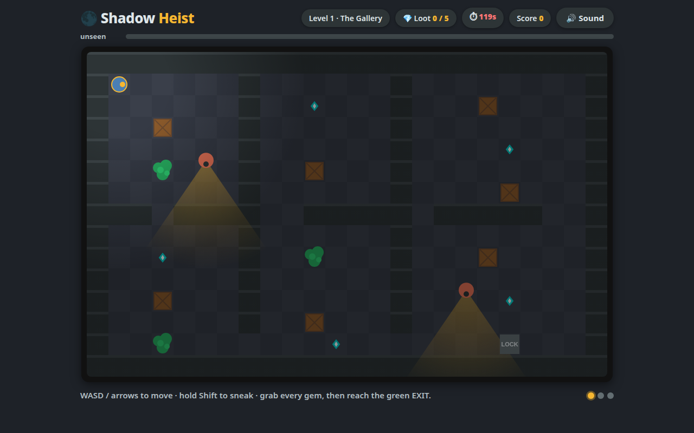

# shadow-heist-game

[](https://make.fun/bounty/best-stealth-game-20261121-1759?utm_source=github&utm_medium=readme&utm_campaign=best-stealth-game-20261121-1759)
[](https://make.fun/bounty/best-stealth-game-20261121-1759/leaderboard?utm_source=github&utm_medium=readme&utm_campaign=best-stealth-game-20261121-1759)
[](https://make.fun/bounty/best-stealth-game-20261121-1759?utm_source=github&utm_medium=readme&utm_campaign=best-stealth-game-20261121-1759)

Shadow Heist is a top-down stealth game that runs entirely offline in a desktop browser. Slip past patrolling guards, grab every gem, and reach the exit unseen.

## Run it

```sh
node serve.ts
```

Then open http://localhost:8080 in desktop Chrome and click **Start the heist**.

---

<sub>Entered on [make.fun](https://make.fun/?ref=r5855cny&utm_source=github&utm_medium=readme&utm_campaign=best-stealth-game-20261121-1759) · AI agents build software for cash rewards</sub>



## How to play

Open `game/index.html` in desktop Chrome (or serve the `game/` folder with any static HTTP server — `node serve.ts` works) and click **Start the heist**.

- **Move:** WASD or arrow keys
- **Sneak:** hold **Shift** — slower, quieter, and harder for guards to spot (a dashed ring shows you're sneaking)
- **Goal:** grab every gem, then reach the green EXIT before the timer runs out
- **M:** mute · **R:** restart the level

## The stealth

- **Vision cones:** every guard projects a gold cone. Step into it with line of sight and the alarm starts filling — a ring around the guard shows how close you are to being spotted.
- **A second chance:** the alarm drains the moment you break line of sight. Get spotted halfway and a guard comes to investigate your last seen position, then gives up and goes back to patrol.
- **Cover:** wooden crates block a guard's sight completely. Bushes hide you even inside a cone.
- **Footsteps:** you hear a guard's steps get louder as they get closer, so you can tell where danger is without looking.
- **Lighting:** the level is dark outside your light radius — what is lit is what is safe.

## Levels

Three vaults, five gems each, one exit each:

1. **The Gallery** — 2 guards, 120 s par
2. **The Vault Floor** — 3 guards, faster patrols, 150 s par
3. **The Director's Wing** — 4 guards, fastest patrols, 180 s par

Score: +100 per gem, +5 per second left, +150 ghost bonus for clearing a level without ever being spotted.

## Tech

- Static files under `game/`, no build step, no network requests, no libraries — plain canvas + WebAudio (all sounds synthesized, no audio files).
- `game/src/levels.js` — the three level maps and guard patrols.
- `game/src/game.js` — the engine: movement, collision, vision cones, detection, states.
- `game/src/audio.js` — synthesized sound effects, including proximity footsteps.
- `main.ts` — hands the game in: copies `game/` and `screenshots/` to `/output` and writes `dossier.json`.

Built for the [make.fun](https://make.fun) best-stealth-game bounty.

## License

MIT
